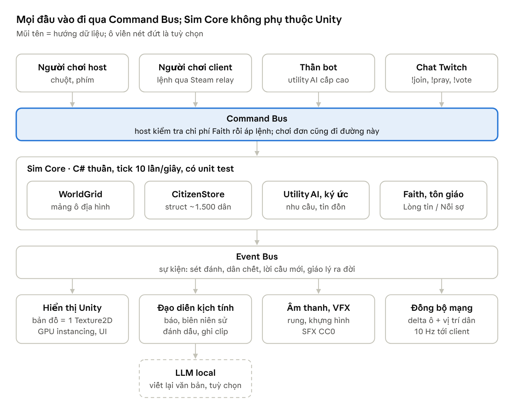
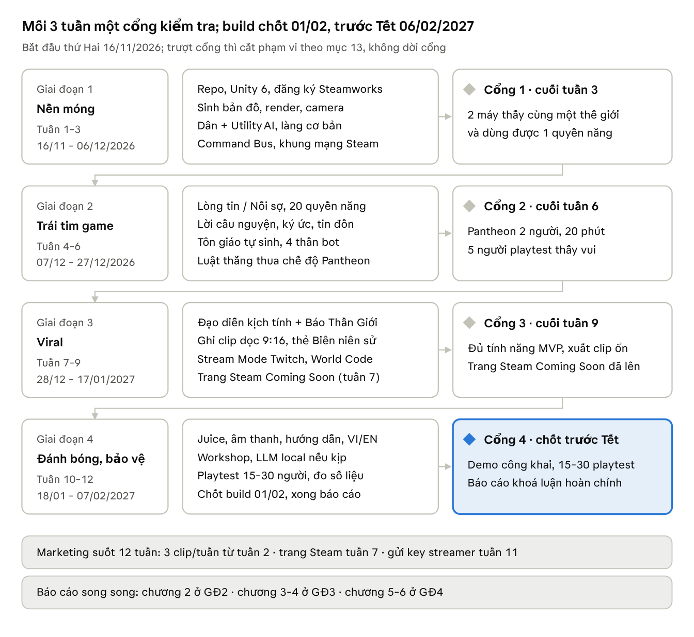

# GDD – Petty Pantheon (Đền Thần Nhỏ Nhen)

16/11/2026

## 1. Tổng quan

**Pitch 1 câu:** WorldBox, nhưng bạn không phải vị thần duy nhất — và dân của bạn biết ghi thù.

Petty Pantheon là game god-sim sandbox 2D pixel, 1–4 người chơi làm các vị thần nhỏ nhen tranh giành tín đồ trong cùng một thế giới. Dân AI cầu nguyện, nhớ ai đã làm gì với họ, tự lập tôn giáo về bạn, và mọi khoảnh khắc hỗn loạn được tự cắt thành clip dọc để chia sẻ.

| Thuộc tính | Đề xuất |
| --- | --- |
| Tên tạm | Petty Pantheon / Đền Thần Nhỏ Nhen (cần tra trùng nhãn hiệu trước khi lập trang Steam) |
| Thể loại | God-sim sandbox + đối kháng/co-op nhẹ, thời gian thực |
| Góc nhìn | 2D top-down, pixel art, bản đồ dạng lưới ô |
| Nền tảng | PC (Windows) trên Steam trước; mobile là bản port giai đoạn 2 (xem mục 7) |
| Engine | Unity 6 LTS, URP 2D |
| Số người chơi | 1–4 thần mỗi thế giới; chơi đơn có thần bot |
| Độ dài phiên | 20–40 phút (chế độ Pantheon) hoặc vô hạn (Sandbox) |
| Mô hình bán | Premium, khoảng 7,99 USD (giá vùng VN thấp hơn), không pay-to-win |
| Người chơi mục tiêu | 13–30 tuổi, fan WorldBox / god game, streamer và khán giả của họ |
| Mục tiêu 12 tuần | Bản demo chơi được online 4 người + trang Steam + bảo vệ khoá luận |
|  |  |

**Giả định đang dùng (cần bạn xác nhận ở mục 14):** 1–2 người làm, code gần như 100% bằng AI (Claude Code / Cursor), ngân sách dưới 5 triệu đồng, art dùng asset pack giá rẻ hoặc CC0 rồi chỉnh màu cho đồng bộ.

## 2. Điểm khác biệt và trụ cột thiết kế

Khác biệt cốt lõi: WorldBox là “một thần, một hộp cát”; Petty Pantheon là “nhiều thần, một đám dân biết phản ứng”. Người chơi không chỉ phá — họ phải được dân tin, và dân nhớ hết.

| Khía cạnh | God-sim sandbox truyền thống (kiểu WorldBox) | Petty Pantheon |
| --- | --- | --- |
| Số thần | 1, chơi đơn | 1–4 thần (người hoặc bot) cùng một thế giới |
| Vai trò của dân | Đối tượng bị tác động | Có ký ức và cảm tình riêng với từng thần, cầu nguyện, bỏ đạo, nổi loạn |
| Tài nguyên của thần | Quyền năng dùng thoải mái | Hai loại: Lòng tin (yêu) và Nỗi sợ (sợ), phải kiếm từ tín đồ |
| Mục tiêu | Sandbox không thắng thua | Sandbox + chế độ Pantheon có thắng thua |
| Kể chuyện | Người chơi tự tưởng tượng | Biên niên sử, báo Thần Giới, lời cầu nguyện, giáo lý tự sinh |
| Chia sẻ | Chụp/quay màn hình thủ công | Clip dọc tự cắt, World Code, Stream Mode cho khán giả tham gia |

**Bốn trụ cột** (mọi tính năng mới phải phục vụ ít nhất một trụ, nếu không thì cắt):

1. **Thần nhỏ nhen** — giọng hài, ganh đua; mọi quyền năng đều có cái giá và hậu quả xã hội.
2. **Dân biết nhớ** — một tia sét làm cả làng sợ bạn trong nhiều năm game; cháu chắt cũng nghe kể lại.
3. **Mỗi thế giới là một câu chuyện** — game tự viết lại lịch sử thành chữ, không cần người chơi tưởng tượng.
4. **Sinh ra để được chia sẻ** — câu hỏi kiểm tra: “cái này có thành một clip 15 giây đáng xem không?”.

**Không làm:** 3D, server MMO, gacha/pay-to-win, sao chép art, UI, tên gọi hay các chủng tộc đặc trưng của WorldBox.

## 3. Gameplay cốt lõi

Người chơi đọc lời cầu nguyện, dùng quyền năng, rồi gánh hậu quả: dân yêu hoặc sợ bạn, và cảm xúc đó là tài nguyên để dùng quyền năng tiếp theo.

### 3.1 Vòng lặp theo tầng thời gian

| Tầng | Người chơi làm gì | Phần thưởng |
| --- | --- | --- |
| 30 giây | Đọc một lời cầu nguyện, ban phước hoặc trừng phạt, xem dân phản ứng | Lòng tin hoặc Nỗi sợ, tiếng cười |
| 5 phút | Mở quyền năng mới, dựng đền, giáo lý đầu tiên ra đời, cướp tín đồ của thần khác | Sức mạnh, lãnh thổ |
| Cả phiên (20–40 phút) | Thắng điều kiện Pantheon hoặc sống sót; nhận Biên niên sử + clip highlight | Nội dung để khoe |
| Giữa các phiên | Mở skin thần, danh hiệu, thử World Code của người khác, thử thách Weekly World | Lý do quay lại |

### 3.2 Kinh tế hai mặt: Lòng tin và Nỗi sợ

- Mỗi tín đồ sinh ra Faith mỗi giây; Faith chia thành **Lòng tin** (từ phép lạ, đáp ứng lời cầu) và **Nỗi sợ** (từ thảm hoạ mà dân *biết* là do bạn).
- Phước lành tiêu Lòng tin; thảm hoạ tiêu Nỗi sợ. Thần hiền phải kiên nhẫn, thần ác phải liên tục khủng bố để có “nhiên liệu”.
- Nỗi sợ sinh nhanh nhưng bất ổn: khi tỉ lệ Nỗi sợ vượt ngưỡng (đề xuất 70%), xuất hiện dị giáo, tín đồ bỏ sang thần khác, và có thể sinh ra **Anh hùng Diệt Thần** đi phá đền của bạn.
- **Quy kết trách nhiệm:** dân chỉ biết thảm hoạ do ai gây khi thấy màu/biểu tượng của thần đó. Đây là nền cho quyền năng “Đổ tội”.

### 3.3 Quyền năng (MVP 20 cái)

| Nhóm | Quyền năng | Tiêu | Ghi chú |
| --- | --- | --- | --- |
| Phước lành | Mưa, Bội thu, Chữa bệnh, Ban con, Ban sức chiến binh, Gửi tiên tri | Lòng tin | Tiên tri đi truyền đạo sang làng khác |
| Thảm hoạ | Sét, Lửa, Lũ, Động đất, Dịch bệnh, Thả quái vật, Thiên thạch | Nỗi sợ | Thiên thạch là “ult”, hồi chiêu dài |
| Nhỏ nhen | Đổ tội, Gieo tin đồn, Cướp công phép lạ, Phát bánh cho dân đạo khác | Cả hai | Trái tim của bản sắc game, sinh nhiều clip nhất |
| Địa hình | Nâng/hạ đất, Tạo nước, Trồng rừng | Rẻ | Miễn phí trong Sandbox |

- *Đổ tội:* thảm hoạ mang màu thần đối thủ, dân ghét họ thay vì bạn; có xác suất bị lộ nếu có tiên tri đứng gần.
- *Gieo tin đồn:* hai làng của hai thần khác nhau bắt đầu nghi kỵ, dễ dẫn đến chiến tranh.
- *Cướp công:* khi thần khác vừa ban phước, bạn trả Faith để nhận công trước mắt dân trong 10 giây.

### 3.4 Lời cầu nguyện

Dân sinh nhu cầu (đói, hạn, bệnh, chiến tranh, ghen tị cá nhân) → lời cầu hiện thành bong bóng trên bản đồ và trong bảng tin. Đáp ứng đúng hạn: Lòng tin x2; bỏ qua: Lòng tin giảm nhẹ. Lời cầu nhỏ nhen (“Xin làm con dê nhà lão Ba bị hói”) cho Lòng tin từ người cầu và Nỗi sợ từ nạn nhân — mỗi lần là một lựa chọn đạo đức nhỏ, dễ thành meme.

### 3.5 Tôn giáo tự sinh

Mỗi thần có một **Hồ sơ Thần** đếm loại hành động đã làm. Cứ mỗi \~5 phút, dân “viết” một giáo lý từ hồ sơ đó: thần dùng sét 70% thời gian → *Giáo phái Sấm Cáu Kỉnh*, điều răn “Không được phơi đồ khi Ngài đang bực”. Mỗi giáo lý cho một buff thụ động (ví dụ tín đồ chịu sét tốt hơn), nên phong cách chơi quyết định build của bạn.

### 3.6 Chế độ Pantheon: thắng thua

- **Thăng Thiên:** giữ ≥60% dân số thế giới là tín đồ trong 3 phút liên tục.
- **Kỳ quan:** tín đồ xây xong Đại Đền (tốn tài nguyên, đối thủ có thể phá).
- **Hết giờ:** điểm Faith tích luỹ cao nhất.
- Thần hết tín đồ không bị loại mà thành **Thần Bị Lãng Quên**: vẫn có 3 quyền năng phá đám nhỏ và có thể “hồi sinh” nếu có người lại cầu nguyện tới mình. Người thua vẫn ở lại phòng và vẫn vui.

### 3.7 Phạm vi mô phỏng MVP

Bản đồ 256×256 ô, tối đa \~1.500 dân, 2 tộc người tự thiết kế (ví dụ dân đồng bằng đông và dân rừng ít nhưng bền), 4 loại quái trung lập, làng phát triển thành thị trấn, chiến tranh giữa làng khác đạo, 4 mùa.

## 4. Hệ thống AI không tốn chi phí

Nguyên tắc: mọi AI chạy trên máy người chơi, không gọi API trả phí nào. LLM chỉ là lớp “trang trí” tuỳ chọn; game phải hoàn chỉnh và vui khi tắt LLM.

| Tầng | Kỹ thuật | Dùng cho | Chi phí |
| --- | --- | --- | --- |
| 1. Não dân | Utility AI: chấm điểm hành động (ăn, làm, ngủ, cầu nguyện, chạy, đánh, truyền đạo) theo nhu cầu và tính cách | Hành vi từng dân | 0 đồng, CPU |
| 2. Ký ức & cảm tình | Mỗi dân 8 ô ký ức (sự kiện, thần, cường độ, thời điểm), phai dần theo thời gian; hai dân gặp nhau thì chia sẻ ký ức mạnh nhất (tin đồn) | Ghi thù, huyền thoại lan truyền | 0 đồng |
| 3. Sinh văn hoá | Ngữ pháp sinh văn bản kiểu Tracery + kho từ Việt/Anh + điều kiện từ Hồ sơ Thần | Tên giáo phái, điều răn, tên làng, tên anh hùng, lời cầu | 0 đồng |
| 4. Đạo diễn kịch tính | Chấm điểm kịch tính mỗi sự kiện (số người chết, độ bất ngờ, đảo chiều, có người chơi liên quan) | Báo Thần Giới, đánh dấu khoảnh khắc cắt clip, đẩy lời cầu kịch tính khi game nhàm | 0 đồng |
| 5. Thần bot | Utility AI cấp cao, 4 tính cách: Hiền, Bạo, Nhỏ nhen, Lười | Chơi đơn, lấp chỗ trống phòng online | 0 đồng |
| 6. LLM local (tuỳ chọn, chỉ PC) | Plugin LLMUnity (nền llama.cpp) + model nhỏ 0,5–1,5 tỷ tham số dạng GGUF 4-bit; hoặc trỏ tới Ollama người chơi tự cài | Viết lại tiêu đề báo, lời trăn trối, lời cầu cho tự nhiên hơn | 0 đồng; tốn RAM/GPU của người chơi |

**Quy tắc cho tầng 6:** chạy bất đồng bộ trên hàng đợi ưu tiên thấp, tối đa vài yêu cầu mỗi phút, luôn có bản template dự phòng hiện ngay; model tải riêng như gói miễn phí tuỳ chọn (cỡ vài trăm MB đến \~1 GB) để không phình bản cài. Kiểm tra giấy phép thương mại của model trước khi đóng gói (ưu tiên model Apache 2.0). Trong multiplayer, chỉ máy host sinh văn bản rồi gửi chuỗi chữ cho client.

**Vì sao không dùng API cloud miễn phí:** giới hạn lượt gọi, điều khoản có thể đổi bất cứ lúc nào, độ trễ, và quan trọng nhất: game càng viral thì chi phí càng tăng — ngược với mục tiêu kinh doanh.

**Ngân sách hiệu năng:** toàn bộ AI tầng 1–5 ≤ 6 ms/khung hình với 1.500 dân trên PC tầm trung. Cách đạt: mỗi khung chỉ cập nhật 1/10 số dân (time-slicing), dữ liệu dân lưu dạng mảng struct, dùng Burst/Jobs khi profiler cho thấy cần.

**Gợi ý cảm hứng (không sao chép):** AI Director của Left 4 Dead và “storyteller” của RimWorld cho tầng 4; hệ thống tin đồn của Dwarf Fortress cho tầng 2.

## 5. Multiplayer

Multiplayer dùng mô hình host-authoritative qua Steam relay: máy một người chơi chạy mô phỏng, người khác chỉ gửi lệnh — không thuê server, chi phí vận hành 0 đồng.

### 5.1 Các chế độ

| Chế độ | Người chơi | Mô tả | Đợt |
| --- | --- | --- | --- |
| Pantheon | 2–4 online (bù bot nếu thiếu) | Tranh tín đồ, có thắng thua, 20–40 phút | MVP |
| Sandbox Co-op | 2–4 online | Cùng xây/phá, không thắng thua, quyền năng miễn phí | MVP |
| Stream Mode | 1 streamer + khán giả qua chat | Khán giả thành dân có tên, bỏ phiếu thảm hoạ (mục 6) | MVP |
| World Code / Workshop | Bất đồng bộ | Tải thế giới người khác, chơi tiếp hoặc phá | Tuần 9–10 |
| Remote Play Together | 2–4 cùng màn hình, bạn không cần mua game | Cần hỗ trợ nhiều con trỏ local bằng tay cầm | Sau phát hành |

### 5.2 Kiến trúc mạng

- **Host-authoritative listen server:** host chạy toàn bộ mô phỏng; client gửi *Command* (“dùng Sét tại ô x,y”), host kiểm tra chi phí rồi thực thi. Chơi đơn cũng đi qua đúng đường này (host offline), nên không có hai bộ code.
- **Transport:** Steam Networking Sockets qua Steam Datagram Relay (miễn phí cho game trên Steam, tự vượt NAT, ẩn IP người chơi). Thư viện: Facepunch.Steamworks hoặc Steamworks.NET. Khi chưa có AppID riêng, test bằng AppID 480.
- **Lobby:** Steam Lobby + mời bạn qua overlay Steam — mỗi lời mời là một lần quảng cáo miễn phí.
- **Đồng bộ thế giới (tự viết, không dùng NetworkObject cho từng dân):**
  - Địa hình: khi vào phòng gửi seed + danh sách ô đã đổi (nén); sau đó chỉ gửi ô thay đổi theo lô mỗi tick.
  - Dân: vị trí + trạng thái lượng tử hoá (\~6 byte/dân), 10 lần/giây, chỉ dân trong vùng camera của client cộng biên. Ước tính 300 dân × 6 byte × 10 Hz ≈ 18 KB/s mỗi client.
  - Sự kiện (thảm hoạ, lời cầu, báo, giáo lý): tin nhắn reliable.
  - Client nội suy vị trí, hiệu ứng chạy ngay phía client để cảm giác không trễ.
- **Tham gia giữa trận:** có, nhờ snapshot. **Host thoát:** phiên dừng; autosave mỗi phút và cho phép người khác tải lại (host migration ngoài phạm vi MVP).
- **Chống gian lận:** host quyết định mọi thứ; game không có rank nên để ưu tiên thấp.

**Vì sao không dùng deterministic lockstep:** lockstep cần mô phỏng giống nhau từng bit trên mọi máy (số thực cố định, thứ tự duyệt cố định, không dùng physics). Code sinh bằng AI rất dễ phá vỡ điều này và lỗi desync cực khó debug — rủi ro quá lớn cho 12 tuần.

## 6. Cơ chế viral tự nhiên

Game lan bằng ba vòng: clip người chơi đăng → người xem mua; streamer bật Stream Mode → khán giả vào game → khán giả mua; người chơi mời bạn thay thần bot → bạn mua. Mỗi vòng đều được thiết kế sẵn trong game, không phụ thuộc quảng cáo.

1. **Clip tự cắt (Khoảnh khắc thần thánh):** game luôn giữ 30 giây gần nhất trong bộ đệm vòng. Khi Đạo diễn kịch tính phát hiện điểm cao, hiện nút “Lưu clip”. Xuất MP4 dọc 9:16, 15–30 giây, camera tự crop quanh sự kiện, tự gắn caption là tiêu đề báo + logo + World Code. Trên PC dùng FFmpeg đi kèm (bản LGPL).
2. **Nhật báo Thần Giới:** ảnh “tờ báo” chia sẻ được, ví dụ *“Làng Bánh Đa bị sét đánh 14 lần, dân làng quyết định chuyển sang thờ con bò”*. Ảnh tĩnh hợp Facebook, Reddit, Discord.
3. **Biên niên sử cuối phiên:** thẻ tổng kết kiểu “Wrapped” với danh hiệu cho từng người (“Kẻ Đổ Tội Chuyên Nghiệp”, “Thần Hiền Nhất Mà Vẫn Thua”). Danh hiệu gây cãi nhau giữa bạn bè = lý do đăng lên.
4. **Stream Mode:** đọc chat Twitch qua IRC (miễn phí; kiểm tra điều khoản Twitch trước khi phát hành). Lệnh: `!join` để thành dân mang tên mình, `!pray <câu ngắn>` để cầu nguyện trong game, `!vote` để bỏ phiếu thảm hoạ. Có bộ lọc từ cấm và giới hạn độ dài. YouTube Live cần API key của chính streamer → giai đoạn 2.
5. **World Code:** chuỗi ngắn (ví dụ `PP-7K3-LUA`) mã hoá seed và thông số; save đầy đủ đưa lên Steam Workshop. Người xem clip có thể chơi đúng thế giới đó.
6. **Weekly World:** mỗi tuần một seed + luật chế (“chỉ được dùng quyền năng nhỏ nhen”), bảng xếp hạng Steam Leaderboards miễn phí. Seed có thể sinh theo ngày từ công thức cố định, không cần server.
7. **Đặt tên dân theo bạn bè:** người chơi nhập danh sách tên, game gán cho dân — nội dung cá nhân hoá, cực dễ đăng story.
8. **Ghế trống:** khi chơi với bot, game nhắc nhẹ “Thần bot đang giữ chỗ — mời bạn vào thay”, mở overlay mời của Steam.

**Tiếp thị song song với lúc code:** từ tuần 2, đăng 3 clip devlog/tuần lên TikTok và YouTube Shorts (chính clip xuất từ game); dựng trang Steam Coming Soon sớm nhất có thể để gom wishlist; gửi key demo cho streamer god-sim và streamer Việt; tham gia Steam Next Fest khi có demo.

## 7. Steam hay Mobile

Khuyến nghị: **phát hành Steam (PC) trước**, thiết kế code sẵn để port Android sau 3–6 tháng. Lý do quyết định: trên Steam, multiplayer, chia sẻ thế giới và LLM local đều miễn phí; trên mobile cả ba đều tốn tiền hoặc khó làm — đúng ba thứ tạo nên sự khác biệt của game.

| Tiêu chí | Steam (PC) | Mobile |
| --- | --- | --- |
| Mạng multiplayer | Steam Datagram Relay miễn phí | Cần relay bên thứ ba; gói free giới hạn số người, viral càng tốn |
| LLM local | Chạy được trên PC tầm trung | Khó: RAM, nóng máy, pin → chỉ dùng template |
| Mô phỏng 1.500 dân | Thoải mái | Phải giảm quy mô trên máy yếu |
| Chia sẻ thế giới | Steam Workshop miễn phí | Phải tự dựng backend lưu trữ |
| Mô hình doanh thu | Premium bán được ngay từ người dùng đầu | Thường là F2P + quảng cáo/IAP, cần lượng tải rất lớn |
| Phí phát hành | 100 USD/game (Steam Direct) | Google Play 25 USD một lần; Apple 99 USD/năm + cần máy Mac để build iOS |
| Được khám phá | Wishlist, Next Fest, hàng đợi khám phá của Steam | Store bão hoà, phụ thuộc mua quảng cáo |
| Streamer | Twitch/YouTube chủ yếu chơi trên PC, Stream Mode dễ làm | Stream mobile khó tích hợp chat |
| Quy mô người chơi | Nhỏ hơn | Lớn nhất, Việt Nam chủ yếu chơi mobile |
| Điều khiển | Chuột chính xác | Cảm ứng rất hợp god game (WorldBox đã chứng minh trên mobile) |

**Làm gì ngay từ đầu để port mobile rẻ:**

- Lớp Input trừu tượng (Input System của Unity), UI co giãn theo màn hình, nút đủ to cho ngón tay.
- Lớp Transport trừu tượng: Steam trên PC; khi lên mobile cân nhắc Epic Online Services (P2P + lobby, miễn phí, đa nền tảng — cần kiểm tra điều khoản khi tới lúc).
- Preset hiệu năng (bản đồ nhỏ hơn, ít dân hơn) điều khiển bằng một file cấu hình.
- Tầng LLM chỉ là plugin, tắt được hoàn toàn.

Bản mobile sau này nên là Android trước (rẻ, không cần Mac), mô hình premium giá thấp hoặc free-to-try mở khoá 1 lần.

## 8. Art, âm thanh, UI và phạm vi nội dung

Phong cách: pixel art đơn giản, đọc rõ ở mức zoom xa, mang chất dân gian Á Đông (đình làng, ruộng bậc thang, cây đa, lễ hội) để khác hẳn WorldBox, nhưng giọng hài đủ phổ quát cho người chơi quốc tế.

- **Bảng màu:** một palette cố định 32–64 màu (chọn từ Lospec, kiểm tra giấy phép) để asset từ nhiều nguồn trông đồng bộ.
- **Nhận diện thần:** mỗi thần một màu chủ đạo + một biểu tượng; mọi quyền năng hiện màu đó. Đây là yêu cầu gameplay (quy kết trách nhiệm, Đổ tội), không chỉ trang trí.
- **“Juice”:** rung màn hình, khựng hình khi sét đánh, dân chạy tán loạn, bong bóng thoại nhỏ. Clip chỉ viral khi từng cú đánh trông đã mắt.
- **Âm thanh:** SFX từ thư viện CC0 (Kenney, Freesound CC0); giọng dân là tiếng líu lo tự sinh bằng đổi cao độ âm tiết (rẻ, dễ thương, không cần lồng tiếng); nhạc nền mua license hoặc đặt riêng 3–4 bài, lấy chất ngũ cung.
- **UI:** trái = thanh quyền năng; phải = dòng lời cầu nguyện; trên = hai đồng hồ Lòng tin/Nỗi sợ và điểm từng thần; dưới = dải chạy tiêu đề Báo Thần Giới. Dùng UI Toolkit.

**Phạm vi nội dung MVP (tuần 12):**

| Nội dung | Số lượng |
| --- | --- |
| Quyền năng | 20 |
| Tộc dân | 2 |
| Quái trung lập | 4 |
| Loại công trình | 10 |
| Sinh cảnh (biome) | 5 |
| Mẫu giáo lý | 30 |
| Mẫu lời cầu nguyện | 150 |
| Mẫu tiêu đề báo | 200 |
| Skin thần | 8 |
| Ngôn ngữ | Tiếng Việt, tiếng Anh |

Mẫu văn bản (lời cầu, tiêu đề, giáo lý) có thể nhờ AI viết hàng loạt trong lúc phát triển rồi lưu thành file JSON — tốn công một lần, chạy miễn phí mãi.

## 9. Kiến trúc kỹ thuật và quy tắc vibecode

Quyết định quan trọng nhất: tách **lõi mô phỏng bằng C# thuần** (không dùng MonoBehaviour) khỏi phần hiển thị Unity, và cho **mọi đầu vào** (người chơi, bot, chat Twitch) đi qua một Command Bus duy nhất ngay từ tuần 1. Hai điều này giúp AI viết code không phá multiplayer, và cho phép test tự động.

**Các khối chính:**

- *Sim Core:* WorldGrid (mảng ô), CitizenStore (mảng struct), các System (Nhu cầu, Utility AI, Ký ức, Faith, Tôn giáo, Chiến đấu, Xây dựng). Tick cố định 10 lần/giây, hiển thị nội suy 60 FPS.
- *Command Bus:* nhận lệnh, host kiểm tra chi phí, áp vào Sim Core.
- *Event Bus:* Sim Core phát sự kiện → Đạo diễn kịch tính, âm thanh, hiệu ứng, bộ ghi clip, lớp mạng.
- *Hiển thị:* WorldRenderer vẽ cả bản đồ vào một Texture2D (chỉ cập nhật ô đổi), dân vẽ bằng GPU instancing; không dùng 65.536 GameObject hay Tilemap khổng lồ.
- *Dịch vụ ngoài:* SteamService (lobby, Workshop, leaderboard), TwitchChatClient, ClipRecorder (FFmpeg), LLMService (tuỳ chọn).
- *Dữ liệu:* quyền năng, giá trị cân bằng, mẫu văn bản đều là JSON/ScriptableObject — chỉnh cân bằng không cần sửa code.

Lệnh đi xuống qua một cửa duy nhất, sự kiện đi ra qua một cửa duy nhất; vì vậy thêm bot, chat Twitch hay LLM không đụng vào Sim Core.

**Gói chính:** Unity 6 LTS, URP 2D, Input System, UI Toolkit, Burst + Collections, Facepunch.Steamworks, Multiplayer Play Mode (test nhiều người trên một máy), LLMUnity (tuỳ chọn), bản FFmpeg LGPL.

**Quy tắc vibecode:**

1. Git từ ngày 1; commit sau mỗi tính năng chạy được; thử nghiệm lớn làm trên nhánh riêng.
2. Đưa GDD này vào repo dạng Markdown + một file luật cho AI (CLAUDE.md hoặc .cursorrules) ghi: kiến trúc, quy ước đặt tên, “Sim Core không tham chiếu UnityEngine”, “mọi input đi qua Command Bus”, “không NetworkObject cho từng dân”.
3. Mỗi prompt một tính năng nhỏ: AI viết → chạy test → bạn chơi thử 5 phút → commit. Không gộp nhiều tính năng vào một lần.
4. Sim Core có unit test và một bài test headless chạy 10.000 tick để bắt crash và đo hiệu năng; AI tự chạy được.
5. Cho AI điều khiển Unity Editor (mở scene, chạy Play Mode, đọc console) bằng công cụ MCP/CLI cho Unity để nó tự kiểm lỗi.
6. Test multiplayer 2 cửa sổ mỗi ngày từ tuần 3 — lỗi mạng phát hiện muộn sẽ rất đắt.
7. Mở Profiler mỗi tuần. Ngân sách: 60 FPS, Sim ≤ 6 ms/khung, RAM < 2 GB khi tắt LLM.

## 10. Lộ trình 12 tuần

Lộ trình chia 4 giai đoạn 3 tuần, mỗi giai đoạn kết thúc bằng một cổng kiểm tra. Tuần 12 trùng Tết Đinh Mùi (06/02/2027), nên build cuối chốt ngày 01/02/2027 và tuần cuối chỉ dành cho báo cáo.

Multiplayer được đặt ngay cổng 1 vì sửa kiến trúc mạng về sau tốn gấp nhiều lần; trượt cổng quá 3 ngày thì cắt tính năng theo mục 13 thay vì dời cổng sau.

## 11. Kinh doanh

Mô hình: game premium trên Steam, chi phí cố định dưới \~500 USD, chi phí vận hành theo người chơi bằng 0 — nên mọi lượt viral đều là lợi nhuận, không phải gánh nặng server.

**Doanh thu:**

- Game gốc \~7,99 USD; bật giá vùng theo bảng gợi ý của Steam (Việt Nam, Đông Nam Á rẻ hơn).
- Ra Early Access khi có đủ nội dung cho \~10 giờ chơi (sau 12 tuần thêm khoảng 2–3 tháng); trước đó chỉ phát demo miễn phí để gom wishlist.
- Supporter Pack 3–5 USD (skin thần, nhạc nền, tên trong credits).
- Gói skin thần và tộc dân mới dạng DLC mỹ phẩm, không bán sức mạnh.
- Bản Android sau 3–6 tháng (mục 7).

**Chi phí dự kiến:**

| Khoản | Ước tính |
| --- | --- |
| Steam Direct (1 game) | 100 USD |
| Asset pack pixel art | 0–150 USD |
| Nhạc nền (license hoặc đặt) | 0–200 USD |
| Công cụ AI code (gói tháng bạn đang dùng) | theo gói hiện tại |
| Server, API AI | 0 USD |

**Ví dụ minh hoạ (không phải dự báo):** bán 5.000 bản với giá thực thu trung bình \~5 USD (sau giá vùng, giảm giá) = \~25.000 USD doanh thu gộp. Sau 30% phí Steam, hoàn tiền và thuế, số về tay có thể còn khoảng một nửa. Người bán ở Việt Nam cần kiểm tra mức khấu trừ thuế Mỹ trong form thuế của Steam và nghĩa vụ thuế trong nước.

**KPI theo giai đoạn:**

| Giai đoạn | Chỉ số | Mục tiêu |
| --- | --- | --- |
| Tuần 12 (demo) | Wishlist | ≥ 1.000 |
| Tuần 12 (demo) | Thời gian chơi demo trung vị | ≥ 20 phút |
| Next Fest | Wishlist tích luỹ | ≥ 7.000 |
| Mọi giai đoạn | Tỉ lệ phiên có xuất clip/ảnh báo | ≥ 10% |
| Mọi giai đoạn | Tỉ lệ phiên có ≥2 người thật | ≥ 30% |
| Ra mắt | Đánh giá tích cực trên Steam | ≥ 80% |

Các chỉ số clip và số người mỗi phiên lấy từ telemetry ẩn danh tự viết (có hỏi đồng ý), cũng dùng làm dữ liệu cho khoá luận.

## 12. Góc khoá luận

Đề tài gợi ý: *“Thiết kế và hiện thực kiến trúc AI lai chi phí bằng không cho kể chuyện nổi sinh trong game mô phỏng thần nhiều người chơi”.* Game là sản phẩm; đóng góp học thuật nằm ở kiến trúc AI và các phép đo.

**Đóng góp có thể bảo vệ:**

1. Kiến trúc AI 6 tầng chạy hoàn toàn trên máy người chơi, LLM chỉ là lớp tuỳ chọn (mục 4).
2. Mô hình ký ức – cảm tình – tin đồn cho hàng nghìn agent trong ngân sách CPU cố định.
3. Kiến trúc multiplayer host-authoritative cho mô phỏng nhiều agent, có số đo băng thông.
4. Cơ chế viral được thiết kế sẵn và đo được bằng telemetry.

**Phương pháp đánh giá:**

| Câu hỏi | Cách đo | Cỡ mẫu |
| --- | --- | --- |
| Mô phỏng có đủ nhanh? | FPS, ms/tick theo số dân 500 / 1.000 / 1.500 / 3.000 | 3 cấu hình máy |
| Mạng có đủ nhẹ? | KB/s mỗi client theo số người 2 / 3 / 4 | 10 phiên |
| LLM local có đáng không? | Thử mù văn bản template vs LLM, chấm Likert về độ hài, mạch lạc, liên quan; đo độ trễ và RAM | 20–30 người |
| Người chơi có thích? | Playtest + bảng hỏi GEQ (Game Experience Questionnaire) + SUS cho UI + phỏng vấn ngắn | 15–30 người |
| Có tạo hành vi chia sẻ? | Tỉ lệ phiên xuất clip, lượt xem devlog, wishlist | Toàn bộ người chơi demo |

**Cấu trúc báo cáo:** (1) Giới thiệu, (2) Cơ sở lý thuyết: god game, utility AI, emergent narrative, netcode, (3) Thiết kế, (4) Hiện thực, (5) Đánh giá, (6) Kết luận và hướng phát triển.

**Lưu ý về vibecode:** hỏi giảng viên hướng dẫn và quy định của trường về việc dùng AI sinh code ngay từ đầu, ghi rõ trong báo cáo. Khi bảo vệ, hội đồng sẽ hỏi sâu về code — mỗi tuần dành 2–3 giờ đọc và giải thích lại những gì AI đã viết.

## 13. Rủi ro và giảm thiểu

Rủi ro lớn nhất là phạm vi: nếu trễ, cắt theo thứ tự LLM local → Workshop → Weekly World → Stream Mode. Không bao giờ cắt: mô phỏng, quyền năng, Lòng tin/Nỗi sợ, lời cầu nguyện, Pantheon online, clip tự cắt.

| Rủi ro | Khả năng | Ảnh hưởng | Giảm thiểu |
| --- | --- | --- | --- |
| Phạm vi quá lớn cho 12 tuần | Cao | Cao | Danh sách cắt giảm ở trên; mỗi thứ Sáu so tiến độ với lộ trình |
| Lỗi multiplayer do code AI sinh ra | Cao | Cao | Command Bus từ tuần 1; test 2 cửa sổ hằng ngày; ghi log lệnh để phát lại lỗi |
| Ít người online, phòng vắng | Cao | Trung bình | Thần bot lấp chỗ; mời bạn qua Steam; game vui cả khi chơi đơn |
| Bị xem là “bản nhái WorldBox” | Trung bình | Cao | Art dân gian Á Đông; trailer luôn mở bằng nhiều thần + lời cầu nguyện; không dùng tên, tộc hay UI giống |
| Mô phỏng chậm khi đông dân | Trung bình | Cao | Time-slicing, mảng struct, Burst; Profiler mỗi tuần; trần dân số cấu hình được |
| Không giải thích được code khi bảo vệ | Trung bình | Trung bình | 2–3 giờ/tuần đọc lại code; viết ghi chú kiến trúc song song |
| Giấy phép (model, asset, FFmpeg, điều khoản Twitch) | Thấp | Cao | File LICENSES.md trong repo ghi nguồn + giấy phép từng thứ ngay khi thêm |
| Thủ tục Steamworks (thuế, ngân hàng, duyệt trang) chậm | Trung bình | Trung bình | Đăng ký Steamworks ngay tuần 1 |
| Kiệt sức khi làm một mình | Trung bình | Cao | Tuần cuối mỗi tháng giảm tải; cắt phạm vi thay vì cắt giấc ngủ |

## 14. Câu hỏi mở

Các câu trả lời dưới đây sẽ điều chỉnh phạm vi và lộ trình; ba câu đầu ảnh hưởng lớn nhất.

1. Nhóm bao nhiêu người? Có ai vẽ pixel art được không?
2. Bạn đã dùng Unity/C# bao lâu, đã từng làm game multiplayer chưa?
3. Ngày bảo vệ chính xác là khi nào? Trường có yêu cầu phần nghiên cứu riêng, và có cho phép dùng AI sinh code không?
4. Thị trường chính là Việt Nam hay quốc tế (ảnh hưởng ngôn ngữ mặc định, giá, kênh marketing)?
5. Ngân sách tối đa bạn sẵn sàng chi cho asset và nhạc?
6. Cấu hình máy dev (GPU, RAM) — để biết có thử được LLM local không?
7. Bạn thích giọng hài “thần nhỏ nhen” và chất dân gian Á Đông, hay muốn hướng khác?
8. Bạn đã có kênh TikTok/YouTube/cộng đồng nào để đăng devlog chưa?
